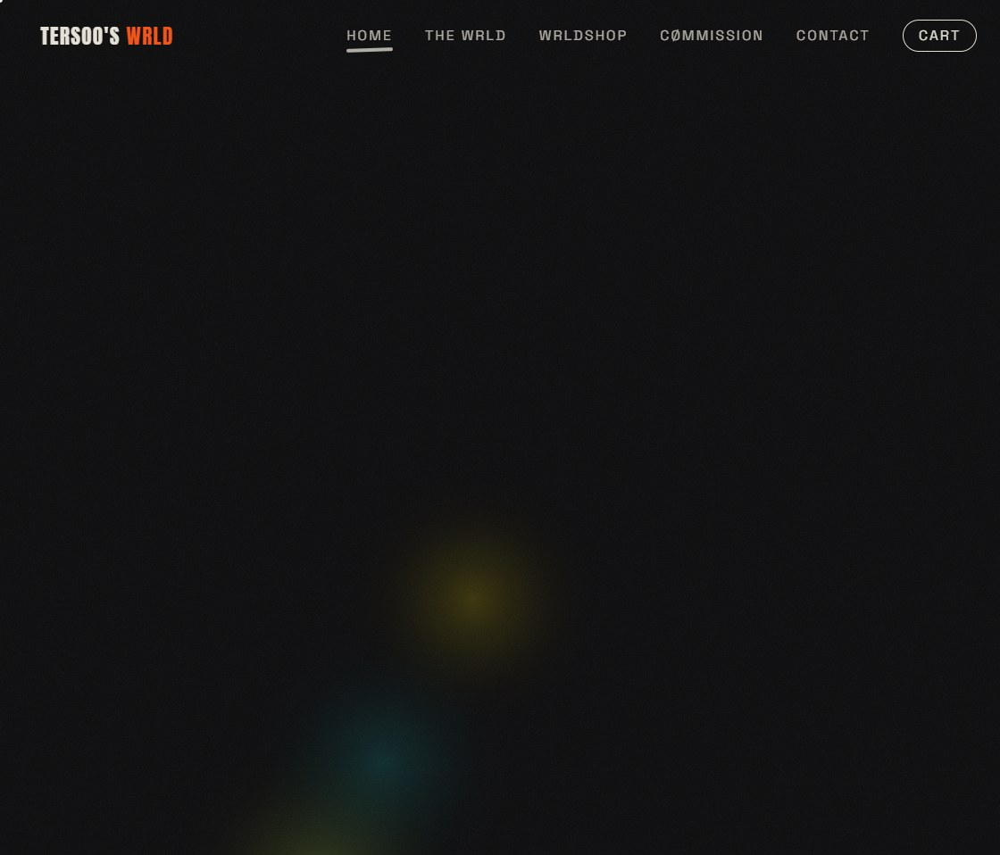
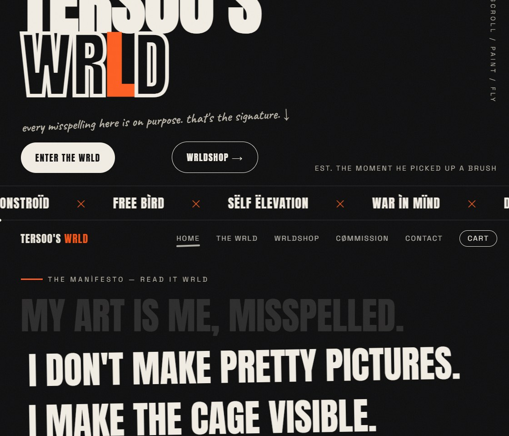
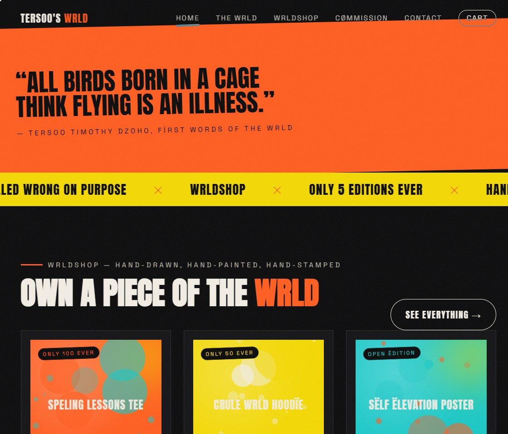
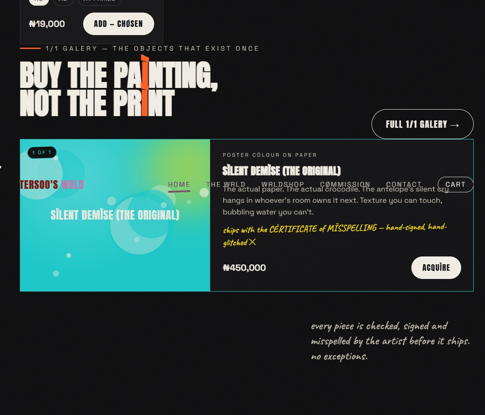
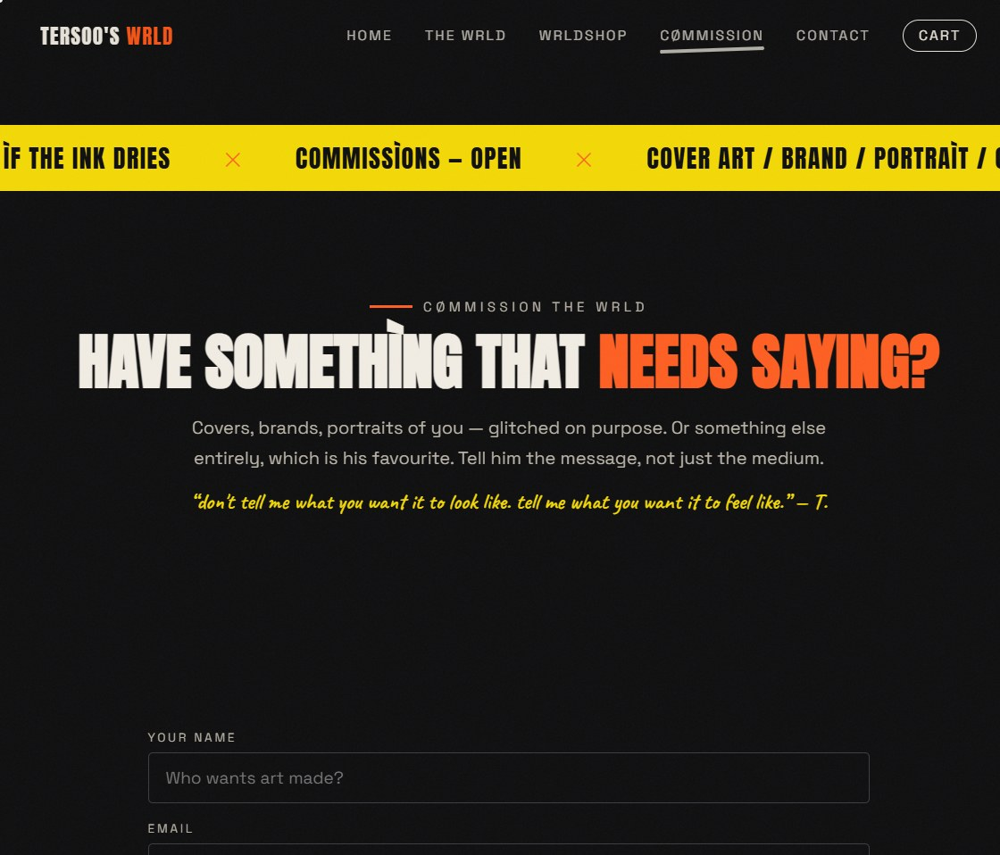

# TERSOO'S WRLD — v1 · the avant-garde rebirth

The loud one. A museum-at-night portfolio + art store for
**Tersoo Timothy Dzoho** — graphic designer & illustrator.
Every misspelling is on purpose. That's the signature.

> **Live for real, forever:** <https://tersoos-wrld-v1.vercel.app>
>
> This was the **proof of concept**. The redesign — version 2, the minimal
> and agreed-upon design — lives in its own repo:
> **<https://github.com/BemFeese/tersoos-wrld-v2>**

---

## The idea

v1 rebuilds the artist's world as a museum after dark: ink-black rooms,
a paint-tip cursor that drips on click, floating paint splatter, breathing
hero lights, marquee tickers, and walls that look hand-cut. The rule was
*the site itself becomes an artwork* — the opposite of minimal; intentional
everywhere.

---

## Screenshots — the avant-garde, live

### The entrance
Breathing paint lamps on black, a hand-cut WRLD wordmark, and the note that
keeps the whole brand honest:



### The corrld (corridor)
The works hang in a **drag-to-walk horizontal gallery corridor** — you don't
scroll past them, you walk through them, with edge-fades like room lighting
and a manifesto wall on the way in:



### WRLDSHOP
Hand-stamped edition tags, tilted cards, a ribbon quote from the artist and
the famous misspelling ticker between rooms:



### The 1/1 gallery
The actual paintings — **buy the painting, not the print** — each with its
medium tag, blurb, and the hand-signed Certificate of Misspelling promise:



### Cømmissions
A quiet-enough form wearing loud clothes: type, budget band, timeline, and
at least twenty characters of intent — briefs land with a `CM-XXXX` stamp:



---

## What it does

Everything in the redesign, plus a few things only the loud version does:

- **Paint cursor + splatter canvas** — the pointer is a paint tip; clicks
  leave real splatter on a floating layer above the page
- **Drag-corridor gallery** — horizontal museum walk with room-light fades
- **Manifesto wall & ribbon quotes** — the artist's words as full walls
- **Marquee tickers** — the misspelling vocabulary marches between rooms
- **WRLDSHOP** — limited editions (tees, prints, objects): `ONLY 100 EVER`,
  `ONLY 50 EVER`, `OPEN ÉDITIØN`; `stock: 0` self-stamps **SØLD**
- **1/1 gallery** — the one-of-one originals with medium plaques
- **Checkout (real, no mocks)** → `POST /api/checkout` re-prices every line
  server-side from the data file (cart tampering buys nothing), stamps the
  order with a `WRLD-XXXX` ref, then: real Paystack initialize + redirect
  with server-verified `/paid?ref=…` when `PAYSTACK_SECRET_KEY` is set, or
  the manual-confirmation flow otherwise. NGN (kobo) throughout.
- **Cømmission intake** → `CM-XXXX` briefs into the ledger
- **Back office at `/admin`** — orders, briefs, subscribers, paid volume.
  Gated by an `ADMIN_KEY` env secret. *(The key is configured privately in
  `.env.local` / host env vars; it is never published here.)*
- **`/paid` verify flow** — polls the ledger until the bank confirms

## How Tersoo manages it (no code, ever)

1. **Add artwork** → drop the file into `public/art/` with the exact
   filename already listed in `lib/data.js` — it appears instantly; a
   hand-styled stand-in holds the slot until then.
2. **Change everything** — works, stories, products, prices, socials:
   all in `lib/data.js`, plainly commented.
3. **Sell an original** → the 1/1 list is under `originals` in `lib/data.js`.

## Stack

- **Next.js 15 (App Router) + React 19** — one-page museum + real commerce
- **Flat-file JSON ledgers** with an in-memory fallback for serverless hosts
- **Paystack** initialize/verify, server-side only
- **Fonts:** Anton (shouting proudly), Space Grotesk, Caveat whispers
- Hand-coded canvas layers (splatter, paint lamps) — no animation libraries

## Run it locally

```bash
npm install
npm run dev        # → http://localhost:3000
```

Production (**stop the dev server first** — building while it runs corrupts
its `.next` cache):

```bash
npm run build
npm start
```

Environment: copy `.env.example` → `.env.local`
(`ADMIN_KEY`, optional `PAYSTACK_SECRET_KEY`, fallback payment link,
contact link). Never committed, by design.

## Deployment notes

Runs on any Node host; deploys cleanly on Vercel serverless (the ledger
falls back to instance memory automatically). This repository is also the
deploy source for the permanent demo at <https://tersoos-wrld-v1.vercel.app>.

---

## Provenance — proof of concept

This site was the **proof of concept** for taking Tersoo's brand world
online: it proved, end to end, that the portfolio, the store mechanics,
the commission flow and the whole misspelling-on-purpose identity could
live on the real web.

The concept then **rescoped**: the loud avant-garde language stepped back
into a minimal, client-approved redesign — **version 2**, built as its own
repository at **<https://github.com/BemFeese/tersoos-wrld-v2>** (live at
<https://tersoos-wrld-v2.vercel.app>). Same engine underneath; opposite
voice on the surface.
